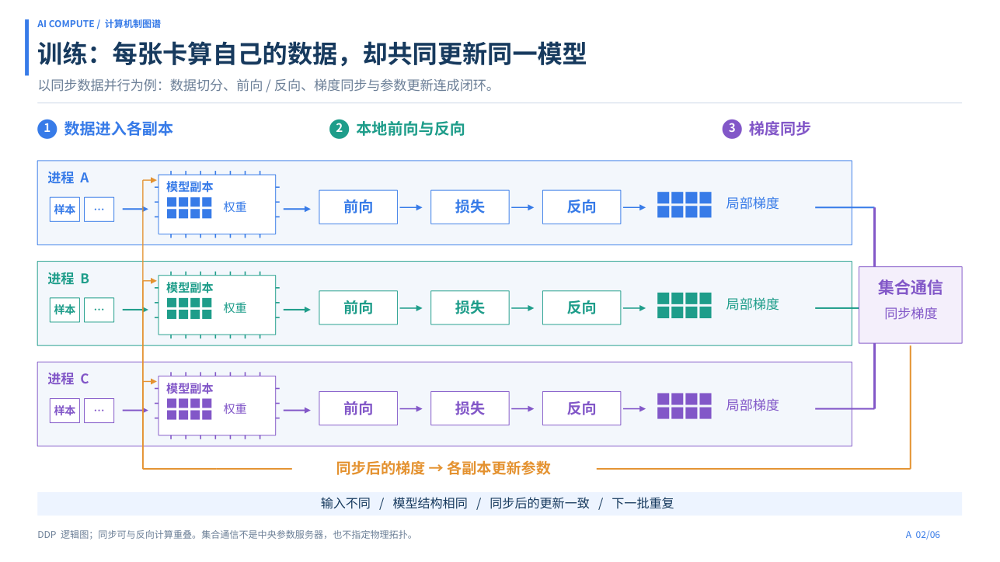
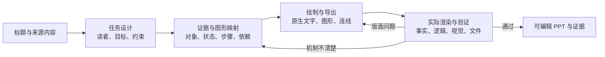

# ppt-agent-design

面向研究报告与技术演示的 PPT Agent 约束、四阶段工作流和可执行绘图示例。目标是把标题与来源内容转成**有内部过程、状态归属和依赖关系的可编辑机制图**。

本仓库提供设计规则和原生绘图实现，不是输入任意标题即可完成自动排版的产品。



## 工作流



四个阶段由同一个任务代理连续执行，不要求启动四个子代理：

| 阶段 | 负责内容 | 入口 |
| --- | --- | --- |
| ppt-task-design | 定义读者、表达目标、输出合同和来源范围 | [SKILL.md](.agents/skills/ppt-task-design/SKILL.md) |
| ppt-mapping | 将事实映射为对象、子过程、状态、依赖和页面 | [SKILL.md](.agents/skills/ppt-mapping/SKILL.md) |
| ppt-dev | 绘制可编辑对象、导出并渲染实际 PPTX | [SKILL.md](.agents/skills/ppt-dev/SKILL.md) |
| ppt-validation | 检查事实、逻辑、图形表达和交付文件 | [SKILL.md](.agents/skills/ppt-validation/SKILL.md) |

## 绘图原则

- **先画语义，再排版。** 先明确输入、内部步骤、状态持有者、通信、输出与必要反馈。
- **展开核心黑盒。** 训练图显示前向/反向、梯度同步与更新；推理图显示请求调度、缓存归属和输出。
- **图形细节必须解释问题。** 不靠增加图标、装饰、数字或空框制造信息密度。
- **关系有明确类型。** 数据流、同步、更新、包含和资源共同占用不能全部画成同一种箭头。
- **文字用于命名和解释图元。** 不设机械字数上限；不能为少字而删掉关键过程。
- **保留证据与边界。** 定量图需真实数据；定性图的块数、面积和距离不暗示性能。
- **检查实际 PPTX 渲染。** 源 SVG、XML 或成功导出不能证明最终版面正确。

完整规则见[分层机制图合同](references/diagram-rich.zh-CN.md)，具体技术见[绘图工作流](architectures/drawing-workflow.md)。

## 快速运行 A 版示例

需要 Python 3.10+。实际渲染另需 LibreOffice 与 Noto Sans CJK SC 字体。

```bash
git clone https://github.com/zishano/ppt-agent-design.git
cd ppt-agent-design
python -m venv .venv
# Linux/macOS；Windows 使用对应的虚拟环境激活方式
source .venv/bin/activate
python -m pip install -r examples/ai-compute/requirements.txt
python examples/ai-compute/build_example.py --output-dir outputs/ai-compute
soffice --headless --convert-to pdf --outdir outputs/ai-compute/A outputs/ai-compute/A/A_分层机制图.pptx
python examples/ai-compute/verify_example.py \
  --pptx outputs/ai-compute/A/A_分层机制图.pptx \
  --pdf outputs/ai-compute/A/A_分层机制图.pdf \
  --report outputs/ai-compute/validation.json \
  --preview-dir outputs/ai-compute/previews
```

输出为六页 16:9 PPT、备注、事实映射、PDF、PNG 与有限自动检查报告。命令中的克隆地址为本仓库的目标发布地址；是否已发布以 GitHub 实际状态为准。

**示例内容和坐标是逐页编写的。** `--facts-file` 只切换证据文件，不会把现成页面自动改成新主题。新主题需同步调整 brief、证据、diagram-map 和绘图代码。详见[示例说明](examples/ai-compute/README.md)。

## 实现与边界

A 示例使用 `python-pptx` 直接生成原生 DrawingML，`PyMuPDF` 提取 PDF 文字并生成预览。布局采用 1280 × 720 设计坐标，转换为 PPT 的英寸与磅；连接线按显式路径布置。没有使用图片生成、Mermaid 或 Graphviz 生成示例页面；上方 Mermaid 仅用于本文档的工作流说明。

节点、文字和连线可编辑，但没有通用自动排版、避障布线、自动语义分组或随节点移动重新布线。自动检查只覆盖文件结构、文字完整性和备注；事实与图形表达仍需审查。验证器因此始终保留 `complete=false`，直至另行完成所需人工/代理审查。

`ppt-master` 是另一个可选择的后端；使用它时必须遵守它的工作流和导出规则。本仓库没有安装或改写其全局规则，独立 python-pptx 路径也不能被当作绕过其门禁的方法。见[后端边界](.agents/tools/ppt-backend.md)。

## 目录

```text
AGENTS.md                        # Agent 总入口
.agents/skills/                  # 四阶段约束与代理元数据
.agents/tools/ppt-backend.md      # 后端选择与能力边界
.claude/skills                   # 指向 .agents/skills 的符号链接
architectures/                   # 流程、门禁与绘图实现
references/                      # 当前图形设计合同
examples/ai-compute/              # 可运行的六页机制图示例与证据
docs/images/                     # 示例实际 PPTX 的渲染预览
```

组织方式参考了 [Simthesizer](https://github.com/casys-kaist/simthesizer) 的阶段分工和可追溯思路；另研究了 [ppt-master](https://github.com/zishano/ppt-master) 的流程与导出边界。示例事实各自保留原始来源与定位，见 [research.facts.json](examples/ai-compute/research.facts.json)。
